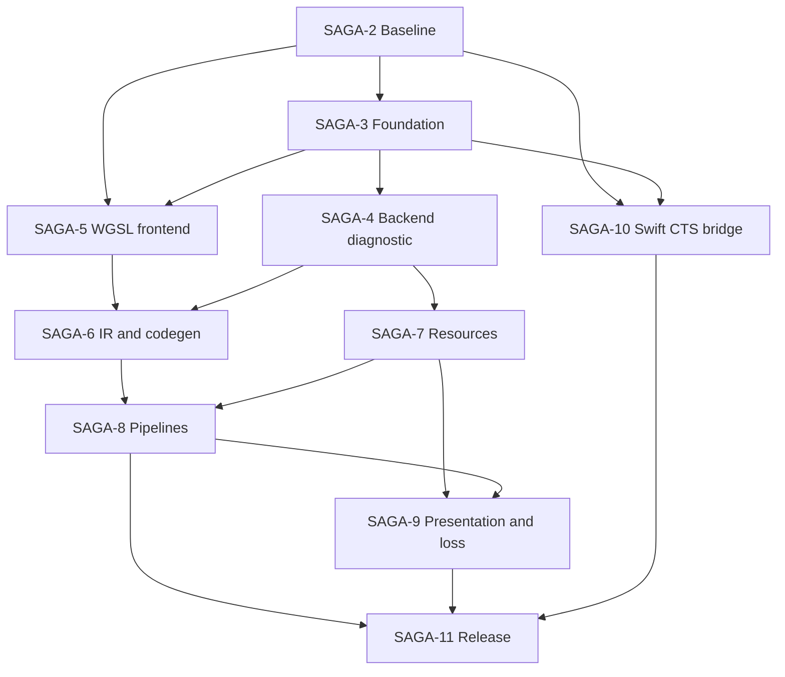

# SAGA roadmap

Baseline: 2026-11-06, task SAGA-2. Repository: `/Users/vlad-prusakov/Developer/saga`.
SAGA-1 is the umbrella and remains **waiting_input**; this baseline does not close it.
All dependencies below reproduce task-tool data from SAGA-2..11, not newly created tasks.
[Machine-readable DAG](roadmap.json) · [Conformance](conformance.md) · [Decision](adr/implement-independent-webgpu.md) · [Provenance](provenance.md).

## Dependency DAG

## Delivery gates

| Task | Prerequisites | Deliverable and measurable exit | Verification required later |
|---|---|---|---|
| SAGA-2 | none | Versioned API/WGSL inventory, denominator definitions, source/license audit, independent implementation ADR; documentation checks pass | Docs validator, source hashes, dependency DAG and references |
| SAGA-3 | SAGA-2 | Swift package API/Core/Backend/WGSL and CI; backend-neutral identities, limits, lifetimes, cancellation/error-scope contracts; public API reviewed | Swift build/test, negative descriptor/lifetime cases, dependency denylist, concurrency ADR |
| SAGA-4 | SAGA-3 | Adapter → device → queue → dispatch → readback on real GPU; every result checked; timeout/no-device explicit; no CPU fallback | Build/test/run and hardware report; saved verified launch recipe; diagnostic native shader is NOT WGSL conformance |
| SAGA-5 | SAGA-2, SAGA-3 | Lexer/parser/AST/source ranges, resolution/types/address spaces/uniformity and diagnostics; explicit rejection of unsupported source | Positive/negative WGSL tests by manifest ID; fuzz/property budgets; malformed input cannot crash/hang |
| SAGA-6 | SAGA-5, SAGA-4 | Independent typed IR/reflection/layouts/builtins/robustness lowering and approved-target codegen | Golden IR tests, emitted-native-shader compilation, WGSL → GPU readback; layout and OOB checks |
| SAGA-7 | SAGA-4 | Buffer/texture/view/sampler/copy/map/destroy state machines and ordering, zero-init, hazards, pre-backend validation | Overflow/alignment/cross-device negatives, GPU copy/map/readback and lifetime stress |
| SAGA-8 | SAGA-6, SAGA-7 | Bind groups/layouts, async pipelines, compute/render passes, draw/indirect/bundles/multisampling per pinned API | Negative binding/layout/pass tests; GPU compute checks and offscreen render comparisons with justified tolerances |
| SAGA-9 | SAGA-7, SAGA-8 | Approved surface integration, acquire/present/resize, negotiation, queries, errors/loss/completion | Fault/cancellation tests, real presentation/resize evidence, feature/limit/query checks; no stranded continuations |
| SAGA-10 | SAGA-2, SAGA-3 | JS host and bridge into Swift; typed arrays/Promises/errors/map semantics; pinned enumeration and sharding | Proof-of-routing, bridge contract tests, positive/negative CTS subset; missing methods fail/unsupported |
| SAGA-11 | SAGA-8, SAGA-9, SAGA-10 | Agreed full scope on approved OS/backend/GPU matrix; no unexplained failures/skips; security/performance and license gates | Separate build/unit/GPU/CTS reports, fuzz/stress/sanitizers where applicable, real benchmarks, dependency/link audit and release readiness |

## Parallelism and decisions

After SAGA-3 API/ownership review, frontend SAGA-5 and bridge SAGA-10 can develop alongside SAGA-4; resource work follows SAGA-4. Bridge completion is not evidence of GPU conformance. A backend-only compute slice must not unlock a full-WebGPU claim.

Accepted platform direction and remaining gates:

- **Accepted by the user:** Apple/Metal + Swift web build/browser WebGPU; see [platform ADR](adr/use-metal-and-browser-webgpu.md). Exact OS/GPU/browser versions, JS interop/host and presentation contracts remain follow-on work.
- **Awaiting human input:** WGSL→MSL versus all Naga formats. The independent Swift compiler remains required; no additional Naga input/output formats are selected by this baseline.
- **Proposed / undecided:** parity with native wgpu extensions, including unsafe/experimental paths. Native register is not silently added to normative WebGPU denominator.
- **Proposed follow-on ADRs:** resource/concurrency model (SAGA-3), concrete Metal/backend contracts (SAGA-4), WGSL frontend (SAGA-5), approved IR/codegen scope (SAGA-6), pipeline validation (SAGA-8), presentation/loss (SAGA-9), CTS routing/browser interop (SAGA-10). These implementation decisions are not made by the accepted platform direction.

Toolchain facts supplied by task context: Swift 6.3.3 / Xcode 26.6 available; target Swift 6.2 language compatibility where feasible. No build was needed or performed for this docs-only task. SAGA-3 must independently verify language mode and approved platform minimums.

## Next action

Review baseline pins and preserve the workflow human-input gate for compiler-format scope; native parity is also undecided. Do not ask the user to choose the already accepted Apple/Metal and browser WebGPU platforms again. SAGA-3 remains subject to that workflow gate before defining the package/API and concurrency boundary. Do not start runtime implementation or claim release readiness from SAGA-2.
